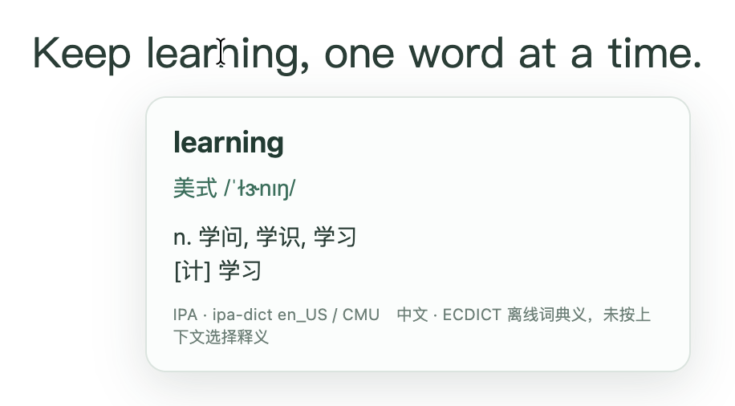
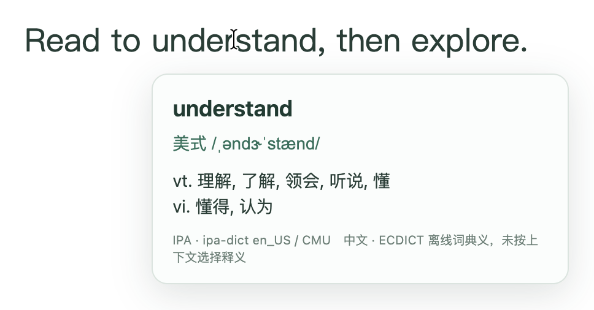

# Shunshou Reader — learn as you read

[简体中文](README.md) | English

Keep reading in English. When a word is unfamiliar, hover over it to see Chinese dictionary definitions and American English IPA.

**Enable the current page once, then hover over individual words. There is no need to click each word.**

*An actual v4.0 hover capture from a local English demo page, including the system text cursor. This is not a v4.1 real-website validation screenshot.*

## Who it is for

- Chinese-speaking readers who study or work in English and want to keep the original text in view.
- People reading courses, articles, or work materials who want to check individual words and pronunciation.
- Anyone who wants local dictionary lookup without an account, paid API, or API key.

## Look up words at your own pace

Hover over a word. A definition card appears after a short delay and disappears when you move away, without changing the page layout.

*Another actual v4.0 capture from a local demo page. The Chinese text is the real product interface: 美式 means American English; 中文 means Chinese; the footer says the definitions are offline dictionary entries, not meanings selected from sentence context.*

Lookup runs locally. The extension does not upload page content, looked-up words, or browsing history. Its dictionary is bundled, so lookup itself does not require an internet connection. Password fields, editable inputs, and content-editable areas are excluded.

## Install and start reading

The current distribution is an unpacked extension for Chrome on Mac. It is **not listed in the Chrome Web Store**. The manifest requires Chrome 110 or later; this is a minimum requirement, not a claim that every Chrome version or operating system has been tested.

1. Download the [v4.1 extension ZIP](https://github.com/janiezhang52-lab/shunshou-reader/releases/download/v4.1/shunshou-reader-4.1-extension.zip), extract it, and keep the extracted folder.
2. Open `chrome://extensions/` in Chrome and enable **Developer mode**.
3. Choose **Load unpacked** and select the extracted `extension` folder.
4. Open an English webpage, click 顺手读 in the Chrome toolbar, and choose **启用当前页** (Enable current page).
5. Hover over an English word you want to look up.

Use **暂停当前页** (Pause current page) to pause. After a full page reload or opening a new tab, enable the page again.

To upgrade, back up the old folder, replace the extension files, and click **Reload** on Chrome's extensions page. Alternatively, disable the old version and load the new `extension` folder. Avoid enabling two versions on the same page. Refresh the reading page and enable Shunshou Reader again.

The [v4.1 release](https://github.com/janiezhang52-lab/shunshou-reader/releases/tag/v4.1) also includes the [full source ZIP](https://github.com/janiezhang52-lab/shunshou-reader/releases/download/v4.1/shunshou-reader-4.1-source.zip) and [SHA-256 checksums](https://github.com/janiezhang52-lab/shunshou-reader/releases/download/v4.1/SHA256SUMS-4.1.txt).

## What to expect

This is word lookup, not full-page translation or context-aware meaning selection. Some entries lack a pronunciation or definition; the card explicitly indicates missing data.

Version 4.1 adds lookup in authorized same-origin nested course frames, dynamically loaded embedded text, web components, read-only form descriptions, and code blocks. It retains per-page authorization with `activeTab` and `scripting`, without requesting persistent access to all websites.

The existing acceptance report records checks on five websites and six content pages: OpenAI Academy, Wikipedia, Python, MDN, and GitHub. Scenarios include deep Academy content and interactive cards, navigation to and from the course outline, toolbar pause/resume, Python code comments, and GitHub navigation from README to CONTRIBUTING. Locked Academy chapters were not counted as passing. These are recorded v4.1 results, not new tests performed for this English documentation update.

**Unsupported:** browser internal pages, text in images, unauthorized cross-origin embeds, extension stores, the built-in PDF viewer, and Canvas text. ChatGPT Learn has not been validated. See the [acceptance report](TEST-REPORT.en.md) for the exact scope and remaining limitations.

## Free personal use

Created by [Ningning](https://github.com/janiezhang52-lab). The original program permits free personal use and free sharing of unmodified copies; selling copies or publicly distributing modified versions is not permitted. Third-party dictionaries retain their own licenses. This is a summary, not a replacement license: the original Chinese [LICENSE](LICENSE) remains authoritative. An English legal translation requires separate confirmation and is not supplied here.

This project has no official affiliation with OpenAI.

## Documentation

- [Release notes](RELEASE-NOTES.en.md)
- [Acceptance report and test commands](TEST-REPORT.en.md)
- [Dictionary sources and limitations](DATA-SOURCES.en.md)
- [ECDICT authorization review](ECDICT-AUTHORIZATION.en.md)
- [Third-party notices](THIRD-PARTY-NOTICES.en.md)
- [Dictionary and privacy](docs/DICTIONARY-AND-PRIVACY.en.md)
- [Screenshot captions](docs/SCREENSHOTS.en.md)
- [Chinese–English coverage and documentation checks](docs/DOCUMENTATION-COVERAGE.md)
